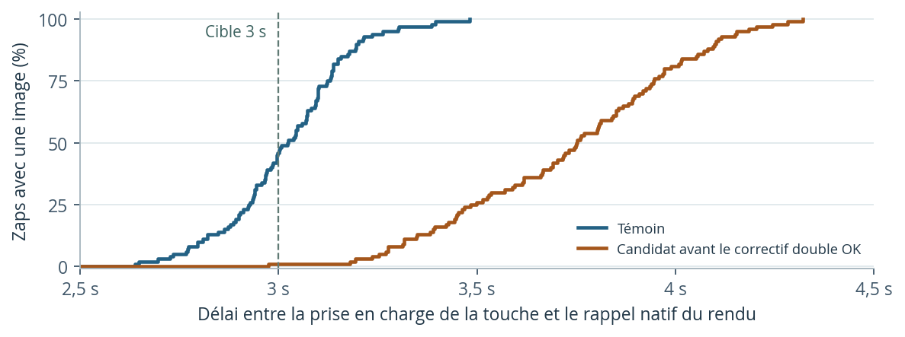
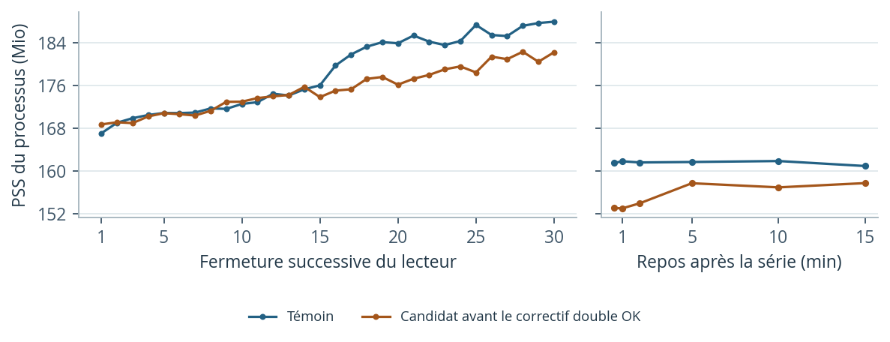

# NovaTube Max TV — Rapport de performance

27 novembre 2026

[Données par essai](mesures.json)

## Décision de publication

NovaTube Max TV · paquet com.sevenmotion.novatube.tv

La PR #275 corrige l’enregistrement HLS et deux ouvertures concurrentes du lecteur. La reprise d’un catalogue envoyé par Atlas est prouvée jusqu’au redémarrage de l’application Android. La supériorité régionale reste à mesurer sur les deux appareils Android TV demandés.

| Objectif | Preuve disponible | Décision |
| --- | --- | --- |
| SHIELD et box de 1 à 2 Go | 0 appareil physique sur 2 qualifié. Les essais Android documentés utilisent des émulateurs. | Seuil de 3 secondes non validé sur matériel. |
| Atlas, 5 000 chaînes HTTP | 2 APK sur 2 ont persisté la révision 1 et les 5 000 adresses distinctes après redémarrage. | P0 reproduit, expliqué et validé sur Android émulé. |
| Capture HLS | 6 segments sur 6 reçus une fois. Vidéo et audio identiques à la source pour le lecteur et le fichier. | Validé pour le HLS MPEG-TS multiplexé en clair. |
| Mémoire après fermeture | La mémoire augmente pendant les fermetures. Après 15 min, le tas natif alloué du candidat reste plus haut qu’au début. | Évaluer la dérive à durée de repos et PID identiques. |
| Lecture continue, émulateur américain | NovaTube 44be9e25 se fige à 57 min 53 s. Televizo avance entre les 1 598 paires de captures sur une heure. | Incident à reproduire sur e322cceb avec un témoin indépendant de la source. |
| Europe et États-Unis | P95 du mouvement visible sur 100 zaps par lecteur, émulation à sortie américaine. Televizo 1,964 s, NovaTube final 3,693 s. | Classement des deux marchés INCERTAIN. |

La PR peut rester en revue avec une diffusion du candidat en test interne. Le score de preuve de la première place reste à 3/10. Il qualifie la preuve disponible pour le classement.

- [PR #275 et discussion technique](https://github.com/manzilionellm-dotcom/tvking/pull/275)
- [Premiers résultats publiés et liens vers les essais](https://github.com/manzilionellm-dotcom/tvking/pull/275#issuecomment-7219132737)

## Point de départ et versions comparées

Repères du rapport initial du 27 novembre. Les résultats de catalogue ci-dessous proviennent du banc Linux décrit dans ce rapport.

| Scénario initial | Témoin | Correctif alors en revue |
| --- | --- | --- |
| Lecture M3U, 20 000 chaînes, médiane / P95 | 102,6 / 126,6 ms | 24,9 / 38,3 ms |
| Recherche de secours, 20 000 homonymes, médiane | 788 ms | 3,4 ms |
| Serveurs locaux pour 16 demandes simultanées | 16 | 1 |
| Enregistrement sur une source HTTP 200 vide | Encore actif après 14 essais | Fermé après 3 essais, en 6,09 s |

### Quelles versions répondent à quelle question ?

| Version applicative | Mesures associées |
| --- | --- |
| fffc1378 | Témoin des mesures initiales, des 100 zaps, des lancements, des fermetures répétées et d’Atlas. |
| 14bdcae6 | Candidat de ces mêmes séries, avant le correctif des doubles appuis. |
| 44be9e25 | Version avec correction du double appui. Ouvertures comparées dans les ordres A/B et B/A, puis contrôle externe des zaps. |
| 8bb86add et suivants | Chronométrage par vue et par révision. Les campagnes et les APK exacts sont identifiés à côté de chaque mesure. |

Le rapport initial situait le démarrage à froid sur cinq essais à 2,875 s puis 3,228 s en médiane. Pendant dix zaps, le CPU passait de 64,9 % à 52,7 % d’un cœur et la mémoire de 145,6 à 147,0 Mio. Les séries plus longues de ce rapport ont des fenêtres et des binaires explicités séparément.

- [Historique de la PR et du banc de départ](https://github.com/manzilionellm-dotcom/tvking/pull/275)

## Lancements et 100 zaps

Campagne Android 11 sur mire HLS locale. Dans chaque cellule, le témoin précède le candidat.

| Opération | Essais valides | Médiane | P95 |
| --- | --- | --- | --- |
| Lancement à froid | 30 / 30 | 4,239 s / 2,337 s | 6,917 s / 3,026 s |
| Retour à chaud | 30 / 30 | 0,138 s / 0,168 s | 2,845 s / 2,498 s |
| Zap, touche → rappel natif | 100 / 100 | 3,023 s / 3,752 s | 3,262 s / 4,154 s |

Le témoin correspond à fffc1378 instrumenté par b475f0b3. Le candidat correspond à 14bdcae6 instrumenté par b53eb8f5. Les lancements utilisent les variantes de profil. Les essais vidéo utilisent les variantes de lecture. Un lancement à froid attribué au lanceur a été écarté de chaque série. Les mesures à chaud conservent le processus. Les deux sessions se sont déroulées sur deux instances hébergées.

Les 100 zaps ont tous produit un rappel natif de rendu sur chaque APK. 46 zaps du témoin et 1 zap du candidat ont pris moins de 3 secondes. L’écart de P95 atteint 0,892 seconde sur cette paire. Une variation de charge entre les hôtes peut contribuer à l’écart.

Sur les fenêtres de cadence émises avant la succession de zaps, les journaux totalisent 851 images rendues et 12 perdues sur 34,652 s pour le témoin, puis 848 rendues et 171 perdues sur 41,179 s pour le candidat. Les fenêtres ont des durées différentes. Cette observation ne couvre pas une heure de lecture.

- [100 zaps et lancements · témoin](https://github.com/manzilionellm-dotcom/tvking/actions/runs/45998784741)
- [100 zaps et lancements · candidat](https://github.com/manzilionellm-dotcom/tvking/actions/runs/45998775045)

## Aperçu et plein écran

### Du relâchement de l’aperçu au rendu

| Mesure | Témoin | Candidat |
| --- | --- | --- |
| Libération de l’aperçu | 39,941 ms | 50,493 ms |
| Initialisation du décodeur rapportée par Media3 | 160 ms | 323 ms |
| De l’initialisation achevée au premier rendu | 102 ms | 1 602 ms |
| De l’ouverture native de la source au rendu | 295 ms | 1 997 ms |
| De la prise en charge de la commande au rappel natif | 3,907 s | 2,798 s |

Cette décomposition porte sur une ouverture par version. Les origines de temps diffèrent selon la ligne. Les valeurs natives sont incluses dans la durée totale. Le compteur Flutter du candidat a annoncé 2,419 s, soit 379 ms avant le rappel natif. Le chronomètre révisé exige le premier rendu de la vue et de la révision actives.

### Un appui OK isolé et horodaté sur le même appareil

Sur la construction 497455cc, l’aperçu est libéré en 19,362 ms et le décodeur est initialisé en 57 ms. Media3 émet le signal 239 ms après l’ouverture native, entre 558 et 1 129 ms après l’injection du seul appui. La réception par le fil principal intervient 2 196 ms après l’émission. Flutter confirme la vue 3 et la révision 0 en 3 189 ms depuis la prise en charge de l’appui.

Les 2 196 ms utilisent la même horloge monotone Android aux deux extrémités. Sur un premier essai de validation (8bb86add), Flutter confirmait le rendu en 3,135 s. Ces ouvertures individuelles n’établissent aucun P95. Une capture optique synchronisée permettrait de dater l’apparition sur la dalle.

- [Mesure de livraison du rendu sur la même horloge](https://github.com/manzilionellm-dotcom/tvking/actions/runs/46008613279)
- [Journal et APK de la mesure par vue et révision](https://github.com/manzilionellm-dotcom/tvking/actions/runs/46005227751)
- [Source Media3 1.5.1](https://github.com/androidx/media/blob/1.5.1/libraries/exoplayer/src/main/java/androidx/media3/exoplayer/video/VideoRendererEventListener.java#L226-L230)

## Trente ouvertures à chaud

Parcours complet sur le même processus Android, avec retour à l’accueil entre deux ouvertures.

| Mesure | Témoin | Candidat |
| --- | --- | --- |
| Touche → signal Flutter, médiane | 3,292 s | 5,464 s |
| Touche → signal Flutter, P95 | 8,262 s | 11,287 s |
| Touche → rappel natif apparié, P95 | 8,262 s | 11,286 s |
| Libération de l’aperçu, P95 | 31,7 ms | 43,9 ms |
| Initialisation du décodeur, P95 | 124,0 ms | 146,0 ms |
| Ouverture native → émission Media3, P95 | 259 ms | 424 ms |

Sur la paire fffc1378 / 14bdcae6, les deux APK ont produit 30 signaux Flutter en 30 essais. Le seuil de trois secondes est atteint 13 fois sur le témoin et 7 fois sur le candidat. Le témoin et le candidat ont tourné sur des hôtes distincts. Chaque rappel Media3 a été apparié à sa vue. Sur trois essais du candidat, Flutter a devancé le rappel natif de 50, 145 et 294 ms. Les médianes par blocs de dix passages vont de 2,914 à 5,958 s pour le témoin et de 3,345 à 9,850 s pour le candidat.

### Ce qui s’est passé pendant l’essai à 11,287 s

Sur le 29e passage du candidat, la libération de l’aperçu a pris 24,391 ms. Media3 indique une initialisation du décodeur en 129 ms et une émission du premier rendu 304 ms après l’ouverture native. À la réception par le fil principal, les rappels « décodeur prêt » et « premier rendu » sont séparés de 9,440 s. Les instants d’émission de ces mêmes événements sont séparés de 116 ms. Flutter a reçu sa confirmation 1 ms après la ligne de rendu native.

La différence entre ces deux intervalles situe une attente supplémentaire d’environ 9,32 s sur la livraison du second rappel par rapport au premier. Un enregistrement visuel synchronisé reste nécessaire pour dater le premier pixel visible.

- [Campagne des 30 passages, deux versions](https://github.com/manzilionellm-dotcom/tvking/actions/runs/46001357861)
- [Media3 1.5.1 · émission du premier rendu](https://github.com/androidx/media/blob/1.5.1/libraries/exoplayer/src/main/java/androidx/media3/exoplayer/video/VideoRendererEventListener.java#L226-L230)

## Effet du correctif du double appui

Deux hôtes Android 11. Chacun a exécuté les deux APK sur la même mire, dans les ordres opposés.

| Appui OK simple | Avant · 14bdcae6 | Après · 44be9e25 |
| --- | --- | --- |
| 30 ouvertures, médiane | 3,441 s | 3,659 s |
| 30 ouvertures, P95 | 6,162 s | 5,544 s |
| Moins de 3 secondes | 8 sur 30 | 6 sur 30 |
| Hôte A puis B, P95 sur 15 essais | 6,176 s | 6,667 s |
| Hôte B puis A, P95 sur 15 essais | 4,658 s | 5,025 s |

Le délai relie la prise en charge de l’appui au rappel natif apparié de la nouvelle vue. Le P95 du groupe de 30 prend le 29e délai trié. Pour chacune des séries de 15, le P95 est le maximum. Le candidat a le plus grand maximum sur chacun des deux hôtes. Une accélération reproductible reste INCERTAINE.

### Après un déplacement de la sélection suivi d’un double OK

Le témoin a traité deux fois l’ouverture de l’aperçu dans 5 essais sur 6. Une seule première image était attribuable sans ambiguïté dans cette série. Le candidat a produit 6 premières images attribuables sur 6 et aucun double traitement. Sur le double appui sans déplacement, les deux versions ont donné 6 ouvertures attribuables sur 6.

Pour les appuis simples, le P95 de libération de l’aperçu passe de 144,0 à 93,5 ms. Le P95 d’initialisation du décodeur passe de 152 à 159 ms et celui de l’ouverture native jusqu’à l’émission du premier rendu passe de 305 à 378 ms. La mémoire totale annoncée par le noyau des deux émulateurs est de 1,93 Gio.

- [Journaux d’ouverture dans les deux ordres](https://github.com/manzilionellm-dotcom/tvking/actions/runs/46004804211)
- [Correctif du double appui](https://github.com/manzilionellm-dotcom/tvking/commit/44be9e254e4fe0e41cd743d74885a2eb3fea91fc)

## Premier rendu sur le candidat final

Le candidat e322cceb attribue le signal du moteur vidéo à la source qui l’a émis. Les tests ont alterné un flux HLS et un flux MPEG-TS progressif sur une même vue.

| Passage au plein écran, un appui OK | Durée observée |
| --- | --- |
| Libération du lecteur d’aperçu | 9,513 ms |
| Initialisation du décodeur Media3 | 104 ms |
| Ouverture native de la source → émission du signal de rendu | 243 ms |
| Injection de la touche → émission du signal, intervalle | 282 à 853 ms |
| Émission du signal → réception du rappel natif | 1 904 ms |
| Prise en charge de la touche → confirmation Flutter | 2 615 ms |

Une vieille notification du lecteur pouvait être attribuée à la nouvelle chaîne lors de changements rapides. Le correctif associe chaque source à sa génération et utilise l’instant consigné par le moteur de rendu. Les quatre zaps alternés ont produit des confirmations de la bonne source sur les générations 1 à 4, en 2,150 s, 2,585 s, 2,223 s et 2,724 s.

Cette série vérifie l’attribution du rendu et explique comment un rappel peut arriver tard. La cible de 3 secondes concerne l’image visible sur chacun des deux appareils physiques.

- [Tests horodatés de changement de source sur Android](https://github.com/manzilionellm-dotcom/tvking/actions/runs/46013659090)
- [Correctif du suivi des générations](https://github.com/manzilionellm-dotcom/tvking/commit/e322ccebbb6f672deffa8b5719cd543d38ecdf3a)

## Plein écran après lancement à froid

Après un lancement Android à froid, le banc ouvre un aperçu, puis demande le plein écran. Lancements à froid acceptés sur les 30 prévus : 30 côté témoin et 30 côté candidat.

| Étape · médiane / P95 (effectif) | Témoin fffc1378 | Candidat 8bb86add |
| --- | --- | --- |
| Commande → rappel natif (s) | 2,920 / 4,041 (30) | 3,581 / 4,284 (30) |
| Commande → signal Flutter (s) | 2,920 / 3,908 (30) | 3,583 / 4,285 (30) |
| Libération aperçu (ms) | 19,088 / 56,674 (30) | 19,999 / 73,954 (30) |
| Initialisation décodeur (ms) | 150,500 / 211,000 (30) | 174,500 / 331,000 (30) |
| Ouverture native → signal Media3 (ms) | 288,000 / 621,000 (30) | 329,500 / 951,000 (30) |

Sur les 30 ouvertures corrélées de chaque version, le rappel natif intervient en moins de 3 secondes dans 17 cas sur le témoin et 4 cas sur le candidat. Ces nombres proviennent des durées individuelles `input_handler_to_native_callback_ms` dans `cold_fresh_fullscreen` des [données par essai](mesures.json). Le rappel inclut le délai du fil principal. La date d’apparition du premier pixel sur une dalle physique reste INCERTAINE.

Les deux séries utilisent une mire locale identique sur deux hôtes émulés. Les fichiers sont indexés par lancement. Une première campagne qui avait écrasé des traces individuelles a été écartée. Les délais publiés portent sur les essais effectivement corrélés.

- [Témoin · traces des lancements](https://github.com/manzilionellm-dotcom/tvking/actions/runs/46014962700/job/140559636076)
- [Candidat · traces des lancements](https://github.com/manzilionellm-dotcom/tvking/actions/runs/46014962700/job/140559635448)

## Essai du plein écran sans fondu

Seule l’animation d’entrée changeait. Deux hôtes ont chacun essayé les deux APK dans des ordres opposés, six fois par condition.

| P95 du premier numéro lisible en plein écran | Avec le fondu | Sans le fondu |
| --- | --- | --- |
| Hôte A puis B | 5,560 à 7,420 s | 5,148 à 7,089 s |
| Hôte B puis A | 4,570 à 5,945 s | 4,699 à 6,208 s |
| 12 ouvertures réunies | 5,560 à 7,420 s | 5,148 à 7,089 s |
| P95 de notification dans l’application | 3,718 s | 3,939 s |

La dernière capture sans repère lisible et la première capture décodable encadrent le délai. Le numéro suivant confirme que la vidéo avance. Le marqueur central peut rester masqué par l’habillage alors que d’autres pixels vidéo sont déjà visibles. Avec 12 observations, le P95 empirique est le maximum.

Les 24 ouvertures ont produit une vidéo animée et un rappel attribuable. L’effet observé change de sens d’un hôte à l’autre. Sur les douze paires comparables, aucun écart ne dépasse l’intervalle d’incertitude de sa capture.

Le fondu de la PR est conservé. La variante expérimentale est restée sur une branche de test.

- [Deux ordres, captures et repères de chacune des 24 ouvertures](https://github.com/manzilionellm-dotcom/tvking/actions/runs/46015591621)

## De la révision Atlas au catalogue sur la TV

Sur les deux APK, le même ordre du panel a été suivi jusqu’à sa persistance dans SQLite et à son accusé.

| Catalogue HTTP | Révision | Témoin | Candidat | Résultat sur chaque APK |
| --- | --- | --- | --- | --- |
| 5 000 chaînes | 1 | 582 ms | 939 ms | 5 000 URL distinctes, 40 catégories, 1 GET |
| 20 000 chaînes | 2 | 3,633 s | 5,563 s | 20 000 URL distinctes, 40 catégories, 1 GET |

Il s’agit d’une observation complète par cellule, sur les APK de profil. Le vérificateur a relu les données alors que le processus était arrêté, puis après le redémarrage. La même révision restait confirmée et le nombre de téléchargements restait à un. Sur la paire d’APK précédente, les confirmations 5 000 chaînes étaient de 670 et 437 ms.

### Pourquoi les premiers essais expiraient à 100 secondes

Les journaux des deux anciens essais montrent trois arrêts rapprochés. BootGuard a détecté une boucle de démarrage et suspendu l’import distant. Le banc corrigé attend le signal de démarrage stable avant chaque arrêt. Lors d’un autre essai, la reconnaissance de texte a lu la tuile Direct derrière l’avis de retrait de l’ancienne liste. Le banc vérifie désormais l’écran atteint et ferme l’avis.

### Cas de coupure de l’accusé

Le test d’intégration interrompt le premier accusé après l’écriture, rouvre la base et relance la synchronisation. Le Worker local reçoit la même révision, et la deuxième lecture indépendante retrouve 5 000 chaînes distinctes. Un ordre suivant dont l’URL répond 403 reste sans accusé et le catalogue précédent reste disponible.

- [Trace initiale et mode sans échec](https://github.com/manzilionellm-dotcom/tvking/actions/runs/45993205826)
- [Témoin · conservation et accusé](https://github.com/manzilionellm-dotcom/tvking/actions/runs/46001425716/job/140513745889)
- [Candidat · conservation et accusé](https://github.com/manzilionellm-dotcom/tvking/actions/runs/46002360434)
- [Correction du banc de navigation et de redémarrage](https://github.com/manzilionellm-dotcom/tvking/commit/5996fb7fb11b00c6b91e009ee64a925d73193532)

## Enregistrement et mémoire

La capture HLS est comparée à la source, image par image et bloc audio par bloc audio, pendant la lecture et sur le fichier terminé.

| Mire HLS contrôlée | Mesure |
| --- | --- |
| 1080p, 30 images/s, 6 secondes | 180 images vidéo et 283 blocs audio identiques par empreinte après décodage, sur les deux sorties. |
| Réseau amont | 1 connexion TCP, 6 segments distincts, 1 requête par segment. |
| Enregistrement | 12 162 472 octets sur la mire 1080p. Les régressions couvrent les manifestes compressés avec gzip et les adresses sans extension redirigées vers un .m3u8. |
| Formats | Segments MPEG-TS en clair, avec son multiplexé. fMP4, pistes audio externes et flux chiffrés restent hors du périmètre validé. |

### Après une fermeture complète du lecteur et de l’aperçu

| Repos après fermeture | Témoin · PSS | Candidat · PSS |
| --- | --- | --- |
| 0 s | 147,56 Mio | 144,57 Mio |
| 30 s | 115,56 Mio | 112,62 Mio |
| 60 s | 115,52 Mio | 112,15 Mio |
| 120 s | 115,30 Mio | 112,27 Mio |
| 300 s | 115,58 Mio | 113,04 Mio |

La PSS mesure la mémoire résidente attribuée au processus, en partageant le coût des pages communes. Le candidat rend 31,53 Mio entre la fermeture et cinq minutes. Entre 30 secondes et cinq minutes, sa PSS augmente de 0,42 Mio. Chaque série conserve le même PID. Une seule fermeture laisse ouverte la question d’une rétention qui s’accumule au fil des usages.

- [Relevés dumpsys et révisions Atlas de la première paire](https://github.com/manzilionellm-dotcom/tvking/actions/runs/45997873071)
- [Capture HLS et test des manifestes gzip](https://github.com/manzilionellm-dotcom/tvking/commit/63f18bf3ecb424a1e5af9da319d21564ef92027b)
- [Redirection vers un manifeste HLS](https://github.com/manzilionellm-dotcom/tvking/commit/779f57e8078439783345d60ee67741b6ba10ec67)

## Mémoire sur 30 fermetures

Mesures dumpsys à l’accueil. Chaque APK a conservé son processus pendant les 30 cycles et les 15 minutes de repos.

| PSS du processus | Témoin | Candidat |
| --- | --- | --- |
| Médiane, fermetures 1 à 5 | 169,90 Mio | 169,13 Mio |
| Médiane, fermetures 26 à 30 | 187,23 Mio | 181,44 Mio |
| Avant la série | 163,77 Mio | 164,70 Mio |
| Après 15 min de repos | 160,92 Mio | 157,71 Mio |

Les médianes des cinq premiers et cinq derniers cycles augmentent de 17,33 Mio pour le témoin et de 12,31 Mio pour le candidat. Sur le candidat, le tas natif alloué passe de 46,25 à 58,05 Mio entre le début de la série et la fin du repos. Une activité Android est restée en mémoire. Le retour de la PSS totale sous son niveau initial et la rétention native peuvent coexister. Une fuite lente reste INCERTAINE.

- [Mesures par cycle et relevés Android complets](https://github.com/manzilionellm-dotcom/tvking/actions/runs/46001357861)

## Origine de la mémoire retenue

Profilage Android 11 sur huit ouvertures du correctif double appui, avec compteurs du processus et échantillonnage des allocations natives.

| Observations, même processus | Après le 1er cycle | Après le 8e cycle | Après 120 s |
| --- | --- | --- | --- |
| Mémoire native allouée | 44,10 Mio | 47,30 Mio | 47,02 Mio |
| Descripteurs de fichiers | 138 | 140 | 140 |
| Fils d’exécution | 47 | 54 | 54 |
| Objets Binder locaux | 54 | 104 | 65 |

La PSS du processus est passée de 176,50 Mio après la huitième fermeture à 147,43 Mio après deux minutes. Le gestionnaire de ressources Android ne déclarait aucun décodeur actif pour ce processus aux huit contrôles après fermeture, ni au repos.

### Ce que le profil d’allocations a identifié

Sur 34 relevés, le solde estimé des allocations présentes atteint 6,25 Mio. Les piles du pilote graphique EGL de l’émulateur associées à getGLString représentent 2,75 Mio (44 %). Les symboles officiels du moteur Flutter, vérifiés par identifiant de compilation, rattachent 3,00 Mio aux tracés, aux glyphes, aux textures et au texte de Skia. Les allocations EGL passent de 0 à 2,75 Mio au fil des réouvertures, puis restent à 2,75 Mio pendant les 130 dernières secondes. Le rendu représente ainsi 5,75 Mio sur 6,25 (92 %). Les 0,50 Mio restants se répartissent entre le compilateur JIT et la table des classes d’Android.

Les allocations sont échantillonnées par pas de 256 Kio. L’origine de ces allocations est identifiée. Leur croissance éventuelle à durée d’utilisation prolongée reste INCERTAINE. Une qualification sur puce physique distinguera le comportement du pilote embarqué de celui de l’émulateur.

- [Profil natif complet, compteurs et libération des décodeurs](https://github.com/manzilionellm-dotcom/tvking/actions/runs/46012585463)
- [Comparaison de l’activité du fil principal sur les deux versions](https://github.com/manzilionellm-dotcom/tvking/actions/runs/46009984660)

## Classement par région

Les 12 combinaisons de région, d’appareil et de lecteur restent à qualifier sur le matériel physique demandé.

| Application | Europe | États-Unis · observations en laboratoire |
| --- | --- | --- |
| NovaTube Max TV | INCERTAIN | Version finale e322cceb, mouvement confirmé pour 100 zaps sur 100. P95 de 3,693 s. |
| Televizo 1.9.9.44-d | INCERTAIN | 100 zaps confirmés sur 100. P95 de 1,964 s, premier des deux lecteurs mesurés sur cette métrique en émulation. |
| TiviMate 5.3.3 | INCERTAIN | Installé sur Android TV émulé. Le premier lancement a présenté des conditions comportant un engagement personnel d’indemnisation. La lecture n’a pas été lancée. |

Les APK TiviMate et Televizo ont été obtenus depuis les sites de leurs éditeurs. Les appareils virtuels américains ont été localisés à partir des données du banc ou du point de sortie réseau. Les segments étaient servis en boucle locale. Le délai d’un fournisseur IPTV et les conditions du réseau résidentiel dans chaque région restent à mesurer.

### Décision de classement

Le classement des trois applications sur les deux appareils est INCERTAIN en Europe et aux États-Unis. Pour le seul zap sur émulateur américain, Televizo est premier des deux lecteurs mesurés et NovaTube deuxième. Le tableau laisse le score vide pour les lectures que le banc n’a pas lancées. Le score de preuve de la première place de NovaTube demeure à 3/10.

- [Pilote commun des trois lecteurs](https://github.com/manzilionellm-dotcom/tvking/actions/runs/46004506404)
- [Vérification du parcours Televizo](https://github.com/manzilionellm-dotcom/tvking/actions/runs/46007134467)
- [Sites des éditeurs · TiviMate](https://tivimate.com)
- [Sites des éditeurs · Televizo](https://televizo.net)

## États-Unis · candidat final

Les 100 commandes de la campagne finale visent la même mire et utilisent la même détection externe que la série Televizo.

| Observation à l’écran | NovaTube e322cceb | Televizo 1.9.9.44-d |
| --- | --- | --- |
| Bonne chaîne dans une première capture, médiane | 3,147 s | 1,552 s |
| Bonne chaîne dans une première capture, P95 | 3,323 s | 1,652 s |
| Bonne chaîne détectée en moins de 3 s | 26 sur 100 | 100 sur 100 |
| Mouvement confirmé, médiane | 3,484 s | 1,865 s |
| Mouvement confirmé, P95 | 3,693 s | 1,964 s |
| Mouvement confirmé en moins de 3 s | 0 sur 100 | 100 sur 100 |
| Succès / commandes | 100 / 100 | 100 / 100 |

Televizo occupe le premier rang des deux lecteurs mesurés sur le P95 de confirmation du mouvement, avec 1,729 s d’avance. Le classement porte sur Android TV 36 émulé, avec des flux HLS locaux à deux chaînes. Les temps incluent la capture du repère à l’écran. La dernière instance NovaTube a utilisé une sortie réseau américaine IAD, celle de Televizo une sortie PDX. La région du centre d’hébergement du candidat n’a pas été renseignée par le banc. La paire antérieure utilisait PDX pour les deux lecteurs.

La première détection atteste que le contenu demandé est visible. La deuxième exige deux numéros de trame distincts et atteste que la nouvelle chaîne est en mouvement. Les deux versions de NovaTube ont chacune leur série indépendante.

- [Candidat e322cceb, preuve télécommande et capture](https://github.com/manzilionellm-dotcom/tvking/actions/runs/46018013177/job/140570041755)
- [Client Televizo et captures](https://github.com/manzilionellm-dotcom/tvking/actions/runs/46007134467/job/140533021307)

## États-Unis · lecture et reprise comparées

Deux lecteurs sur Android TV 36 émulé. Les deux sessions utilisaient les mêmes mires HLS locales à 25 images par seconde.

| Observation | NovaTube 44be9e25 | Televizo 1.9.9.44-d |
| --- | --- | --- |
| Lecture, session de 60 minutes | Dernier changement de numéro à 57 min 52,926 s. Écran d’erreur en fin de session. | 1 599 captures lisibles. Le numéro avance entre les 1 598 paires successives. |
| Coupure demandée de 5 s | ≤ 2,546 s | ≤ 2,431 s |
| Coupure demandée de 15 s | ≤ 3,187 s | ≤ 1,217 s |
| Coupure demandée de 60 s | ≤ 4,106 s | ≤ 2,440 s |
| Images perdues par le décodeur sur l’heure complète | INCERTAIN. Media3 a compté 86 759 rendues et zéro perdue dans 3 470,367 s de fenêtres. | INCERTAIN. Les captures espacées ne dénombrent pas toutes les images. |

Les délais de reprise sont des bornes supérieures entre le rétablissement du réseau et deux images numérotées en mouvement. Chaque durée de coupure a été testée une fois par lecteur. Pour 5 s, les deux lecteurs affichaient encore du mouvement en fin de coupure. Les données disponibles ne permettent ni de calculer un P95 de reprise ni de classer la perte totale d’images.

Les sessions de lecture prolongée utilisaient des instances différentes de même configuration, avec sorties réseau US via PDX pour NovaTube et MSP pour Televizo. Un intervalle entre deux captures peut masquer une brève interruption.

- [Traces NovaTube, vidéo de sortie et trafic HTTP](https://github.com/manzilionellm-dotcom/tvking/actions/runs/46010491329/artifacts/15207672921)
- [Traces Televizo et compteurs réseau](https://github.com/manzilionellm-dotcom/tvking/actions/runs/46014984876/artifacts/15212171566)

## États-Unis · version 44be9e25

Televizo précède NovaTube sur les deux mesures visuelles du zapping. Chaque application a affiché la bonne chaîne sur 100 commandes sur 100.

| Temps depuis la commande | Televizo 1.9.9.44-d | NovaTube 44be9e25 |
| --- | --- | --- |
| Première capture de la bonne chaîne, médiane | 1,552 s | 3,296 s |
| Première capture de la bonne chaîne, P95 | 1,652 s | 3,485 s |
| Mouvement confirmé par deux numéros successifs, médiane | 1,865 s | 3,658 s |
| Mouvement confirmé, P95 | 1,964 s | 3,887 s |
| Mouvement confirmé en moins de 3 s | 100 sur 100 | 0 sur 100 |
| Étendue des confirmations du mouvement | 1,451 à 2,055 s | 3,277 à 4,039 s |

Televizo occupe le premier rang des deux lecteurs pour le P95 de confirmation du mouvement sur ce banc. NovaTube occupe le deuxième. Écart observé de 1,923 s. La première capture montre un écart de P95 de 1,833 s. Les délais incluent le temps de prise des captures. Sa médiane était de 0,337 s pour Televizo et 0,523 s pour NovaTube. Les plages des 100 confirmations ne se chevauchent pas.

Chaque lecteur a reçu les mêmes commandes et les mêmes deux mires HLS 1080p25, sur deux instances Android TV 36 de même configuration. Les deux sorties réseau ont été identifiées US/PDX. Le noyau indiquait 1 503 188 Kio dans les deux cas. Les flux de test provenaient d’un serveur local à chaque banc.

- [Série Televizo et captures](https://github.com/manzilionellm-dotcom/tvking/actions/runs/46007134467/job/140533021307)
- [Série NovaTube et captures](https://github.com/manzilionellm-dotcom/tvking/actions/runs/46004506404/job/140524164768)

## Lecture observée des deux applications

La première campagne a enregistré des fenêtres de deux minutes jusqu’à une rupture de liaison avec l’observateur Android.

| Contrôle de lecture | Televizo | NovaTube |
| --- | --- | --- |
| Dernière preuve de mouvement depuis le début | 42 min 06 s | 24 min 04 s |
| Vidéo effectivement capturée | 2 519,460 s | 1 439,664 s |
| Images de capture avec repère identifié | 64 390 | 37 749 |
| Intervalles entre captures supérieurs à 41 ms | 24 500 | 13 740 |
| Trames de la mire absentes dans les intervalles continus | 1 | 0 |

L’intervalle nominal de la mire est de 40 ms. Les trous du dispositif de capture empêchent d’attribuer un nombre d’images perdues au décodeur sur l’intégralité des sessions. Le saut de trame observable de Televizo peut aussi provenir de la capture. Les deux couvertures ont des durées différentes.

Pour chaque lecteur, le transfert d’un enregistrement d’écran a échoué, puis le contrôle ADB est passé hors ligne. Le serveur continuait à répondre à des requêtes de segments. Une interruption de cette liaison d’observation ne permet pas de dater une interruption de la lecture.

- [Journal des 21 fenêtres Televizo](https://github.com/manzilionellm-dotcom/tvking/actions/runs/46007134467/job/140533021307)
- [Journal des 12 fenêtres NovaTube](https://github.com/manzilionellm-dotcom/tvking/actions/runs/46004506404/job/140524164768)

## Android 11 · 100 zaps suivis par Media3

100 commandes sur deux chaînes HLS locales 1080p25. 100 commandes d’injection ont abouti. 100 premiers rendus sont attribués à une commande grâce à l’horodatage, à la vue et à la révision du flux.

| Étape mesurée | Médiane | P95 |
| --- | --- | --- |
| Traitement de la touche par NovaTube → notification Dart du premier rendu | 2,476 s | 2,726 s |
| Marqueur avant injection Android → notification native | 2,631 s | 2,887 s |
| Ouverture native → signal de rendu Media3 | 0,812 s | 0,950 s |
| Initialisation du décodeur | 0,072 s | 0,100 s |
| Décodeur prêt → signal de rendu Media3 | 0,068 s | 0,090 s |

Sur les 100 commandes, 100 ont reçu le signal dans l’application en moins de 3 secondes. Le maximum confirmé est de 2,929 s. Les commandes sans preuve univoque sont au nombre de 0. Les percentiles portent sur les observations confirmées.

Émulateur Android 11, application 8bb86add, variante ec95c239. La mesure native s’arrête à l’émission du signal Media3. La notification peut parvenir plus tard à l’application. La sortie du téléviseur requiert une mesure optique distincte.

- [Journal des entrées, événements Media3 et captures Android](https://github.com/manzilionellm-dotcom/tvking/actions/runs/46007804631/job/140535298923)

## Android 11 · une heure de lecture

Une fenêtre de 3599,983 s a été mesurée après les zaps, sur les mêmes flux de test. 61 relevés du processus ont retrouvé le même PID et le même instant de création.

| Compteurs Media3 sur les fenêtres mesurées | Résultat |
| --- | --- |
| Fenêtres de cadence complètes | 1 786 |
| Images rendues par le décodeur | 89 961 |
| Images perdues par le décodeur | 0 |
| Part perdue parmi les images rendues et perdues | 0,00 % |

Les fenêtres totalisent 3598,51 s. Sur l’axe de réception du journal, la couverture estimée est de 3598,34 s, avec 1 intervalles découverts de plus d’une seconde et un maximum de 1,422 s. Ces intervalles quantifient des lacunes de télémétrie.

Le décodeur de mire exécuté chaque minute a identifié 0 des 61 observations. Le recadrage des PNG conservés a permis de relire 5/5 compteurs de trame (0 min → A 688, 15 min → A 2188, 30 min → A 687, 45 min → A 2187, 60 min → A 686).

Les compteurs décrivent la sortie du décodeur. Les pertes du compositeur, de la sortie HDMI ou de la dalle restent INCERTAINES.

- [Journaux de cadence, identité du processus et captures PNG de la mire](https://github.com/manzilionellm-dotcom/tvking/actions/runs/46007804631/job/140535298923)

## États-Unis · lecture longue et coupures NovaTube

Android TV 36 émulé, mire HLS locale 1080p25. Révision applicative 44be9e25, compilation de mesure 2e018b0f. Sortie réseau américaine via PDX, région physique de l’hôte INCERTAINE.

L’observation a duré 3 600,058 s. Le dernier changement de numéro apparaît à 57 min 52,926 s. Le numéro 999 reste visible jusqu’à 58 min 02,052 s, puis les 52 dernières captures perdent le repère. L’écran final signale que la chaîne ne répond plus et propose une relance manuelle. La lecture continue sur 60 min échoue sur cet essai.

1 479 des 1 531 captures ont identifié la chaîne A. Le même PID est présent sur les 172 contrôles, sans exception fatale relevée. Durant la fenêtre analysée, le serveur a renvoyé 3 464 réponses HTTP 200. Le dernier segment TS, n° 1 879, a reçu HTTP 200 à 14 h 55 min 28 s UTC. La source répétait sa mire de 120 s et devait rester disponible 110 min. Faute de sonde de la source après la dernière requête, la cause de l’arrêt est INCERTAINE.

Media3 a dénombré 86 759 images rendues et 0 perdues (0,000 %) dans 1 733 fenêtres totalisant 3 470,4 s. Ces compteurs portent sur la sortie du décodeur.

### Coupures du serveur de mire

| Demandé (observé) | Paquets rejetés | État avant rétablissement | Mouvement après rétablissement |
| --- | --- | --- | --- |
| 5 s (6,07 s) | 6 | Mouvement dans les 2 dernières secondes | ≤ 2,546 s |
| 15 s (15,13 s) | 10 | Même numéro relevé sur 6,8 s | ≤ 3,187 s |
| 60 s (60,07 s) | 42 | Image figée puis repère illisible en fin de coupure | ≤ 4,106 s |

La dernière colonne chronomètre la confirmation par deux numéros à l’écran après le rétablissement. Si la lecture s’est poursuivie, ce délai mesure la détection du mouvement. Les sondages espacés ne comptent pas chaque image sur la dalle.

- [Exécution et archive des mesures](https://github.com/manzilionellm-dotcom/tvking/actions/runs/46010491329/artifacts/15207672921)
- [Job Android TV et identité de l’exécutable](https://github.com/manzilionellm-dotcom/tvking/actions/runs/46010491329/job/140544444051)

## Fin de la lecture sur le banc américain

À la fin de l’heure, NovaTube 44be9e25 affiche le nom de la chaîne de test et propose de réessayer.

La dernière progression du numéro de trame a été observée à 57 min 52,926 s. Le serveur a répondu HTTP 200 à sa dernière requête de segment. Le dernier numéro visible, 999, correspond à la dernière trame attendue du segment 1 879. L’épuisement du tampon est compatible avec cette observation. Aucune sonde indépendante n’a vérifié ensuite que le segment suivant restait disponible, et le journal intégral des erreurs Media3 manque.

Pour reproduire cet arrêt sur le binaire final, enregistrer en parallèle la progression du manifeste depuis un second client, les requêtes du lecteur, les erreurs Media3 et la vidéo de sortie. Ces quatre traces permettront d’attribuer l’interruption au serveur, au chemin réseau ou au lecteur.

- [Capture finale et journal HTTP originaux](https://github.com/manzilionellm-dotcom/tvking/actions/runs/46010491329/artifacts/15207672921)

### Interruptions contrôlées du tunnel sur le même APK

Deux émulateurs ont exécuté le même APK historique (`d8d4a1b3…17cb145`) pendant 80 minutes chacun. Le banc a retiré le tunnel réseau `adb reverse` pendant 110 secondes à deux reprises, aux minutes 2 et 10. Sur un émulateur, le flux passait par ce tunnel. Sur l’autre, le lecteur accédait directement au serveur de mire.

| Chemin vers la mire | Observations sur 80 minutes |
| --- | --- |
| HTTP direct | La sonde a reconnu la chaîne sur 1 944 captures sur 1 944. Les 1 943 paires successives ont montré du mouvement. Le plus long intervalle entre deux observations de mouvement a été de 3,147 s. |
| Tunnel `adb reverse` | Les deux suppressions du tunnel ont provoqué deux arrêts de l’image. La sonde a revu le mouvement 7,355 s puis 3,181 s après le rétablissement du tunnel. Le plus long intervalle entre deux observations de mouvement a atteint 109,985 s. |

Ces interventions reproduisent un gel dû au chemin réseau du banc. La cause de l’incident spontané à 57 min 53 s reste **INCERTAINE**. La campagne initiale ne disposait pas d’une sonde indépendante qui aurait pu confirmer la disponibilité du segment suivant après la dernière requête.

- [Mesures optiques et journal des interruptions, accès direct](https://github.com/manzilionellm-dotcom/tvking/actions/runs/46029158432/artifacts/15220051776)
- [Mesures optiques et journal des interruptions, tunnel](https://github.com/manzilionellm-dotcom/tvking/actions/runs/46029158432/artifacts/15219124914)

## Televizo · Coupures et lecture prolongée

Televizo 1.9.9.44-d. Android TV 36 émulé, mémoire annoncée de 1503188 Kio. Sortie réseau US via MSP (centralus). Mire HLS 1080p25 hébergée sur le banc.

### Reprise après interruption de la source

| Coupure demandée | Durée observée | Paquets rejetés | Mouvement après retour¹ | Observation |
| --- | --- | --- | --- | --- |
| 5 s | 5,98 s | 8 | 2,43 s | Mouvement maintenu en fin de coupure |
| 15 s | 15,14 s | 16 | 1,22 s | Mouvement retrouvé après rétablissement |
| 60 s | 61,02 s | 61 | 2,44 s | Mouvement retrouvé après rétablissement |

¹ Borne supérieure du délai entre le rétablissement du réseau et deux numéros d’image successifs. Le lecteur peut continuer à diffuser les données déjà en mémoire.

### Lecture sur une heure

Durée chronométrée 3600,0 s. 1599 captures sur 1599 montrent la mire A. La première et la dernière capture lisible sont espacées de 3599,4 s. 1598 paires successives montrent une progression du numéro d’image.

Intervalle maximal sans nouvelle capture identifiée 2,45 s. Paires successives ayant conservé le même numéro 0. Le pas de capture ne permet pas de compter toutes les images perdues entre deux observations.

- [Journaux, repères vidéo, échantillons et compteurs réseau](https://github.com/manzilionellm-dotcom/tvking/actions/runs/46014984876/job/140559707464)

## Coupures du chemin média

Un essai par durée et par APK. Un compteur incrusté dans la vidéo permet d’observer si le contenu avance.

| Durée visée | Témoin | Candidat | Observation |
| --- | --- | --- | --- |
| 5 s | 5,100 s | 5,716 s | Image encore animée en fin de coupure sur les deux APK. |
| 15 s | 15,201 s | 15,238 s | Image encore animée en fin de coupure sur les deux APK. |
| 60 s | 60,109 s | 60,053 s | Image figée en fin de coupure. Mouvement revu dans les 4,950 s et 2,568 s suivant le rétablissement. |

Le pare-feu du banc Android 11 bloquait le port HTTP de la mire. Le réseau de contrôle et la génération de la vidéo restaient actifs. Pour les coupures de 5 et 15 s sur le candidat, le compteur du pare-feu est resté à zéro et le lecteur a continué à afficher les données déjà reçues. Sur la coupure de 60 s, 31 paquets ont été rejetés. Les valeurs après rétablissement sont des bornes supérieures mesurées au nouvel échantillon animé.

Le témoin et le candidat correspondent à fffc1378 et 14bdcae6. Les trois durées représentent des situations distinctes. Les six observations précisent le comportement sur ce banc et ne suffisent pas à établir un P95 de reprise régional.

- [Captures temporelles, compteurs réseau et résultats des deux APK](https://github.com/manzilionellm-dotcom/tvking/actions/runs/46001357861)

## Publication et critères de sortie

### Validation du candidat

Sur la révision applicative e322cceb, la suite Flutter générale de la CI compte 1 248 tests réussis et 20 ignorés. Les 263 tests de logique Kotlin du lecteur ont réussi. Les contrôles du Worker et du panel ont également réussi.

### Test interne

Construire depuis la révision retenue un AAB avec le paquet com.sevenmotion.novatube.tv et les paramètres NOVATUBE_TV et PLAY_BUILD. Vérifier le certificat d’envoi correspondant à la fiche Play et un versionCode supérieur à celui déjà accepté. L’APK de test issu du code e322cceb a le versionCode 1795787319 et une signature de test temporaire. Son empreinte SHA-256 complète figure dans les données de mesure.

### Qualification sur le matériel demandé

Reproduire en priorité l’arrêt observé en fin d’heure avec une sonde indépendante du flux sur le candidat final. Sur une NVIDIA SHIELD et une box de 1 à 2 Go, relever le modèle, la RAM, Android, le codec et les empreintes. Alterner l’ancien et le nouveau binaire sur chaque appareil. Mesurer 30 lancements à froid, 30 à chaud et 100 zaps par version. Pour le plein écran, conserver le délai télécommande → première image animée, le P95 et tous les échecs. Déclencher le test fermé une fois le P95 inférieur à 3 secondes sur chaque modèle pour le parcours visé, Atlas persistant et mémoire stable après les cycles.

### Classement et production

Réaliser le comparatif depuis des clients physiquement situés dans chaque région. Utiliser les mêmes modèles, les mêmes flux et les versions identifiées des trois applications. Compter une expiration dans le dénominateur. Publier le P95, les échecs, les trames visibles manquantes et la reprise après 5, 15 et 60 secondes de coupure. Figer le binaire et les critères avant la dernière série. Réserver cette série à la confirmation indépendante et publier les écarts défavorables ainsi que les ex æquo.

Pour la production, retenir la construction testée, vérifier qu’une mise à jour conserve listes et favoris, puis ouvrir progressivement le déploiement. Surveiller les applications sans réponse (ANR), les plantages et les échecs de lecture à chaque palier. En cas de dégradation reproductible, suspendre le palier et livrer le correctif avec un versionCode supérieur. L’indisponibilité d’un flux fournisseur sur le banc d’origine (code 884, zéro octet) laisse la performance de ce fournisseur INCERTAINE.

Le P95 correspond à la 95e observation triée sur 100 essais. Inclure les échecs dans le dénominateur et publier séparément les délais censurés. Rendre un rang par métrique, appareil et région. Une première place sur l’ensemble du protocole exige que toutes les comparaisons prévues soient mesurées et favorables, avec les ex æquo signalés.

- [Suite Flutter du candidat](https://github.com/manzilionellm-dotcom/tvking/actions/runs/46009928576/job/140542534128)
- [APK de test et preuve de compilation](https://github.com/manzilionellm-dotcom/tvking/actions/runs/46010144518/artifacts/15204347371)
- [Recette de construction de la fiche NovaTube Max TV](https://github.com/manzilionellm-dotcom/tvking/blob/feature/novatube-review-access-20261122/.github/workflows/novatube-max-play-review.yml)
- [Mires communes et lecture des numéros de trame](https://github.com/manzilionellm-dotcom/tvking/commit/beaf4073e4cdb6904d83239275e6e00bcdffdd8b)
