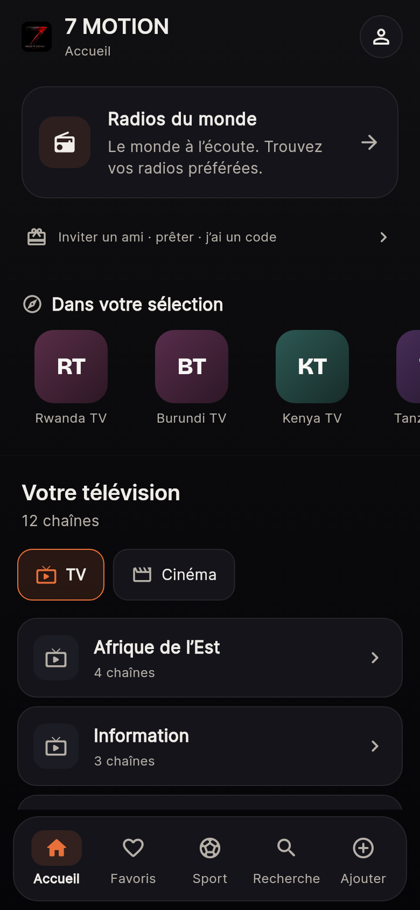
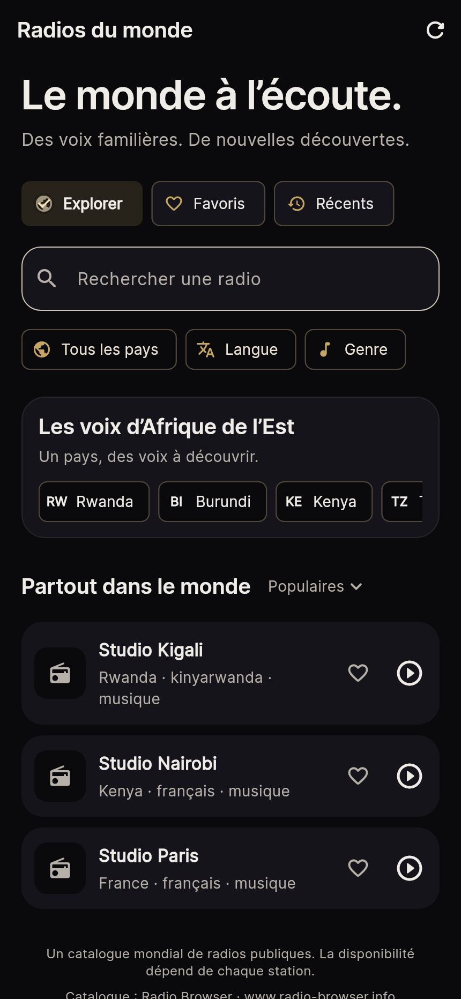
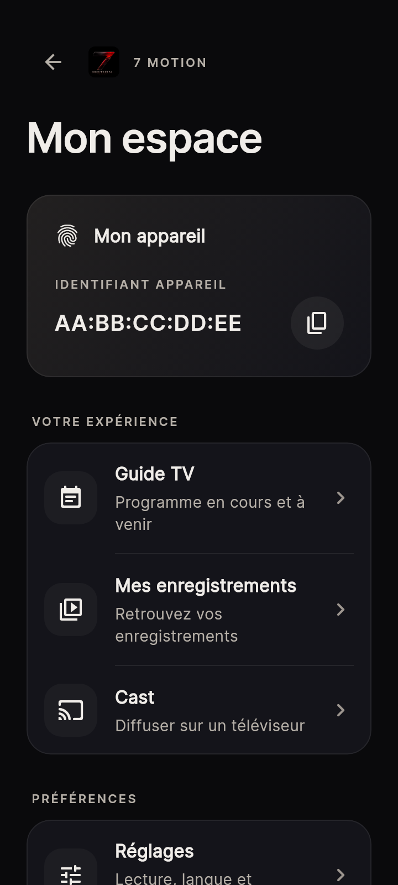
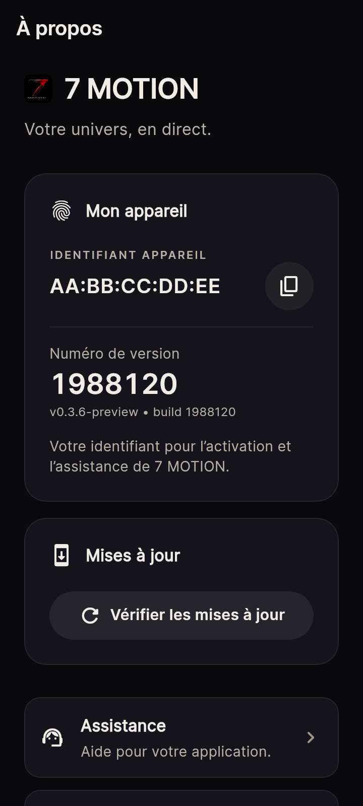

# 7 MOTION — Recherche et direction de design premium

**Date : 16 octobre 2026.** Périmètre : application mobile Android, avec une attention particulière à la radio. Cette note documente les recherches, les arbitrages et les vérifications attendues. Elle ne constitue ni une preuve de publication ni une validation de l'APK sur téléphone.

## Besoin et méthode

Le client apprécie désormais le fonctionnement de l'application et demande une refonte visuelle plus premium, de meilleurs textes et une offre radio plus riche, notamment en Afrique de l'Est. L'objectif est de rendre le contenu plus agréable à parcourir et plus facile à retrouver, en préservant les corrections de lecture et de synchronisation.

La recherche compare six produits : Spotify, Apple Music, Netflix, Radio Garden, TuneIn et myTuner. Elle distingue trois niveaux de preuve :

- **Documentation produit officielle** : décrit des choix effectivement annoncés ou documentés ; elle n'établit pas leur supériorité pour tous les utilisateurs.
- **Avis publiés dans les boutiques** : donnent des signaux qualitatifs, souvent dépendants d'une version, d'un pays ou d'un abonnement. Les avis visibles ne sont pas un échantillon représentatif.
- **Recommandations d'accessibilité** : fournissent des critères vérifiables de contraste, de taille des cibles et de mise à l'échelle. Elles ne dictent pas une direction artistique unique.

Les sources ont été consultées le **16 octobre 2026**. La date d'une page et celle d'un avis sont distinguées de la date de consultation. Aucune statistique de préférence, de conversion ou de lecture n'est déduite de cette recherche.

## Comparaison des six applications

| Produit | Organisation documentée | Signal utile pour 7 MOTION | Limite de transposition |
| --- | --- | --- | --- |
| Spotify | Bibliothèque avec recherche, filtres, tri, épinglage et grille visuelle ; accès aux contenus personnels. [S1, S2] | Faciliter le retour aux favoris et aux contenus récents ; adapter la présentation au contenu. | La page présentant la bibliothèque date de 2021. Ne pas la présenter comme une capture exhaustive de l'interface actuelle. |
| Apple Music | Recherche par catégories et mots-clés, bibliothèque organisée, sélection personnelle et écoutes récentes dans l'accueil. [S3] | Donner un rôle précis à chaque écran ; combiner une sélection principale avec un accès rapide à ses habitudes. | Les recommandations Apple Music reposent sur un catalogue et des données que 7 MOTION ne possède pas nécessairement. |
| Netflix | Raccourcis plus visibles et informations de choix mises en avant dans la refonte TV 2025 ; navigation mobile simplifiée et découverte visuelle annoncées en 2026 ; reprise et liste personnelle regroupées. [S4–S6] | Une carte éditoriale peut donner du caractère, mais reprise, recherche et favoris doivent rester faciles à atteindre. | Une interface TV ne se transpose pas directement au téléphone. Le flux de clips est une stratégie de découverte, pas une obligation pour une app radio. |
| Radio Garden | Exploration géographique, recherche et favoris ; avis portant sur la découverte mondiale et la simplicité. [S7] | Mettre en scène les pays et les régions tout en conservant une recherche directe. | Certains avis apprécient l'exploration, d'autres demandent une interface plus simple : pas de consensus démontré. |
| TuneIn | Accueil avec sélections, stations régionales, catégories et récents ; favoris accessibles dans la bibliothèque et le lecteur. [S8, S9] | Utiliser pays, genres et récents comme accès complémentaires ; rendre favori et commande de lecture faciles à retrouver. | L'ordre des catégories varie selon la région. Une structure documentée n'est pas la preuve d'un usage majoritaire. |
| myTuner | Recherche par station, sélection de pays, favoris, ajout de station et explication des flux indisponibles. [S10] | Une offre riche doit rester navigable ; les erreurs de lecture doivent être compréhensibles. | Le nombre de stations annoncé par un autre service ne décrit pas le catalogue de 7 MOTION. |

## Signaux qualitatifs et contradictions

- **Radio Garden, juillet–septembre 2026** : un avis demande une interface plus propre et un retour à la station précédente ; un autre souhaite des listes personnelles et un meilleur historique ; un troisième apprécie l'exploration et les favoris. Ces retours justifient de proposer exploration et accès direct, sans imposer le même parcours à tous. [S7]
- **Spotify, septembre 2026** : des avis visibles critiquent les interruptions, les obstacles à l'accès aux contenus aimés et la perte de contrôle de l'ordre d'écoute. Le signal concerne le contrôle et la continuité, pas une préférence de couleur ou de police. [S11]
- **TuneIn, août–septembre 2026** : richesse du choix appréciée, mais interruptions répétées et problèmes de lecture décrits. La qualité perçue dépend aussi du fonctionnement réel. [S12]
- **Apple Music Android, août–septembre 2026** : certains utilisateurs apprécient le service tout en décrivant des difficultés de connexion ou de démarrage audio. Une refonte visuelle ne doit pas dégrader les parcours existants. [S13]
- **myTuner, novembre 2025** : un avis d'utilisateur VoiceOver signale que recherche et favoris sont devenus inaccessibles après une refonte. C'est un signal d'accessibilité à prendre en compte, sans prétendre qu'il représente tous les utilisateurs. [S14]

La recherche ne prouve pas que « les gens préfèrent tous le noir et l'or ». La direction sombre, les accents chaleureux et une typographie éditoriale constituent une **proposition créative adaptée à 7 MOTION**. Netflix expérimente une découverte visuelle animée, tandis que des auditeurs radio réclament davantage de simplicité : il faut arbitrer selon le besoin d'écoute rapide du client.

## Audit initial du code mobile

Observations faites avant l'achèvement de cette refonte ; les fichiers pourront évoluer pendant l'implémentation.

| Zone | Observation initiale | Conséquence et décision |
| --- | --- | --- |
| `SimpleHomeScreen` | En-tête, annonce, reprise, accès Invité et entrée Radio s'empilent avant les catégories. | Réduire la concurrence verticale et donner priorité au contenu utile. Conserver les fonctions secondaires accessibles. |
| Navigation de l'accueil | La barre du bas appartient à l'accueil ; les destinations ouvrent des routes qui la recouvrent. | Ne pas présenter cette barre comme une navigation persistante sans travail d'architecture correspondant. |
| Typographie | Inter, Bricolage Grotesque et Manrope coexistent, avec plusieurs labels petits et très espacés. | Consolider les rôles typographiques et la lisibilité avant d'ajouter une police. |
| Couleurs de texte | `textTertiary` initial `#7E7872` sur `surface #14141A` : contraste calculé **4,21:1** ; sur `surfaceHigh #1C1C24` : **3,88:1**. | Insuffisant pour du petit texte soumis au seuil de 4,5:1 ; éclaircir ou utiliser une couleur de texte plus lisible. |
| Texte estompé | `textMuted` initial `#4E4A45` sur `surface #14141A` : **2,09:1**. | Réserver ce niveau aux éléments réellement désactivés, pas aux descriptions nécessaires à l'usage. |
| États et vocabulaire | Des textes techniques, des marques historiques et des présentations hétérogènes peuvent apparaître selon les écrans. | Harmoniser les libellés visibles, sans simuler un abonnement ou un état de lecture. |

Les ratios ont été calculés à partir des couleurs opaques initiales, selon la luminance relative sRGB. Les couleurs finales, transparences, images et modes clair/sombre doivent être vérifiés séparément.

Un commentaire du code attribue environ 70 % des lectures Netflix à la reprise. Cette statistique n'a pas été vérifiée : **elle n'est pas retenue comme preuve**.

## Décisions de conception retenues

1. **Hiérarchie commune à l'application.** Titres identifiables, textes courts, surfaces et espacements cohérents entre accueil, radio, profil, listes et fiches. Une sélection mise en avant ne doit pas empêcher de rejoindre rapidement un contenu connu.
2. **Contenu avant décoration.** Affiches pour films et séries, logos contenus proprement pour chaînes et radios, visuels régionaux pour la découverte. Éviter les effets permanents qui réduisent la lisibilité ou la fluidité.
3. **Contrôle visible.** Favori rempli ou vide, action de lecture claire, reprise explicite et état de chargement distinct d'une lecture effective. Préserver la logique de lecture déjà corrigée.
4. **Radio mondiale par défaut.** Le catalogue mondial reste le point de départ. L'Afrique de l'Est devient un accès privilégié, avec des raccourcis de pays, sans enfermer l'utilisateur dans cette seule région ni déduire automatiquement sa préférence de sa localisation.
5. **Richesse honnête du catalogue.** Les résultats Radio Browser sont dynamiques. Un compteur doit décrire les résultats réellement chargés ou retournés, avec son périmètre. Aucun nombre total fixe de radios n'est promis ; aucune garantie que tous les flux fonctionnent en permanence n'est donnée.
6. **Favoris et récents utiles.** Recherche et filtres doivent permettre de retrouver rapidement une station ; changer de présentation ne doit pas effacer une sélection personnelle.
7. **Ton français clair.** Préférer des libellés concrets tels que « Radios du monde », « Afrique de l'Est », « Vos favoris », « Écoutes récentes », « Rechercher une radio » et « Réessayer ». Adapter le tutoiement ou le vouvoiement de manière cohérente avec les traductions existantes.

La refonte livrable couvre l’accueil, la découverte radio, le profil et À propos. Les autres écrans héritent des ajustements de contraste et de l’accent partagé ; ils n’ont pas tous été redessinés. Les composants visuels conservent les choix personnels de couleur.

## Accessibilité et vérifications attendues

Les recommandations Android demandent notamment un contraste de 4,5:1 pour le petit texte, de 3:1 pour le grand texte, des cibles tactiles d'au moins 48 × 48 dp et des descriptions d'action exploitables par les lecteurs d'écran. Material documente une navigation basse de trois à cinq destinations avec icône et libellé. Flutter recommande de vérifier l'interface avec le texte agrandi jusqu'à 200 %. [S15–S17]

| Vérification | Résultat attendu | État à renseigner par l'intégrateur |
| --- | --- | --- |
| Écrans mobiles étroits et texte agrandi | Aucun débordement bloquant ; défilement possible. | Tests Flutter : accueil à 320 dp et texte 200 % ; profil/À propos à 360 dp et 200 % ; radio à 320×568 et 740×320, 200 %. Réussis. |
| Modes et accents pris en charge | Hiérarchie lisible ; sélection autrement que par la couleur. | Captures sombres/claires revues. L’accent du thème Material suit désormais le choix utilisateur. Texte tertiaire sombre éclairci. |
| TalkBack et cibles tactiles | Actions nommées et atteignables. | Libellés lecture/favori/recherche/retour contrôlés ; dock et réorganisation mesurés ≥48 dp. Essai TalkBack sur téléphone non réalisé. |
| Navigation | Retour cohérent et fonctions accessibles. | Profil : retour visible ; catégories, réorganisation et quatre actions du dock testées. Mode Enfants conserve la découverte sans afficher les catégories filtrées. |
| Radio : monde et régions | Monde par défaut et filtres explicites. | Test monde → Rwanda → effacer → tous les pays réussi. Tris serveur, erreurs, ordre UUID et pagination couverts par les tests du client HTTP local. |
| Favoris et récents | Persistance et ordre cohérents. | Retrait favori résistant à une réponse ancienne ; historique par profil de 30 UUID max, enregistré après progression du média ; corruption et écritures concurrentes testées. |
| Flux radio | États honnêtes, aucune ancienne session attribuée à la nouvelle. | Tests avec PlatformPlayer de contrôle : arrêt/ouverture sérialisés, ancien événement ignoré, historique après progression. Écoute native et disponibilité des stations sur téléphone non vérifiées. |
| Régressions | Contrôles adaptés à la modification. | 44 tests ciblés réussis ; analyse des fichiers modifiés sans problème ; 17 tests de protection de publication réussis. La suite générale locale a été bloquée par la revue automatique sur un test réseau : elle n’est pas déclarée validée. |
| Reconstruction | Même code que celui testé. | Patch radio cumulatif appliqué après Sport puis suivi du patch panel, dans l’ordre de CI, sur une copie propre de la base mobile. Arbre reconstruit strictement identique à celui testé : `06216ca0918b88dba45ce7f317ccc22190aa6945`. |
| Livraison | Distinguer code, validation et APK. | Nouveau code préparé pour la branche d’intégration protégée. Aucun nouvel APK n’est annoncé construit ou publié à ce stade. |

L'analyse statique seule ne valide ni le rendu visuel sur téléphone ni la disponibilité réelle de chaque radio. La publication d'un APK ne signifie pas que les propositions de cette note ont toutes été livrées.

## Aperçus du rendu Flutter

Ces captures proviennent des vrais widgets de l’application, avec un catalogue et un identifiant fictifs réservés aux tests. Elles illustrent l’interface ; elles ne prouvent ni l’écoute d’une station ni une installation sur téléphone.

| Accueil | Radios |
|---|---|
|  |  |

| Profil | À propos |
|---|---|
|  |  |

Les styles principaux utilisent 13 fichiers de police officiels embarqués (2,26 Mo, licences OFL et provenance jointes), pour que leur chargement ne dépende plus du réseau. La découverte radio et les nouveaux textes sont disponibles en français, anglais et swahili. Les autres langues conservent leur mécanisme de repli existant pour les nouvelles clés radio.

## Sources

Toutes les URL ci-dessous ont été consultées le **16 octobre 2026**. Les documents produit servent à comparer des approches ; les avis servent uniquement à identifier des problèmes ou attentes exprimés.

- **S1 — Spotify, présentation de la bibliothèque, 29 avril 2021** : https://newsroom.spotify.com/2021-04-29/listeners-can-explore-their-spotify-collections-faster-and-easier-with-a-new-your-library-2/
- **S2 — Spotify, tri et filtres** : https://support.spotify.com/ly-en/article/sort-and-filter/
- **S3 — Apple, démarrer avec Musique sur iPhone** : https://support.apple.com/en-euro/guide/iphone/iph850be8527/27/ios/27
- **S4 — Netflix, expérience mobile, 30 avril 2026** : https://about.netflix.com/en/news/introducing-exciting-new-ways-to-find-and-enjoy-your-next-favorite-on-mobile
- **S5 — Netflix, refonte TV, 7 mai 2025** : https://about.netflix.com/en/news/unveiling-our-innovative-new-tv-experience
- **S6 — Netflix, My Netflix, 24 juillet 2023** : https://about.netflix.com/en/news/introducing-my-netflix-a-one-stop-shop-for-series-and-movies-you-want-to
- **S7 — Radio Garden, fiche et avis Google Play** : https://play.google.com/store/apps/details?id=com.jonathanpuckey.radiogarden
- **S8 — TuneIn, fonctionnement de l'accueil** : https://tunein-help.freshdesk.com/en/support/solutions/articles/151000172062-what-is-the-home-screen-
- **S9 — TuneIn, favoris** : https://help.tunein.com/en/support/solutions/articles/151000172216-how-do-i-favorite-something-
- **S10 — myTuner, FAQ officielle** : https://mytuner-radio.com/faq/
- **S11 — Spotify, fiche et avis Google Play** : https://play.google.com/store/apps/details?gl=IN&hl=en-GB&id=com.spotify.music
- **S12 — TuneIn, fiche et avis Google Play** : https://play.google.com/store/apps/details?hl=en-CA&id=tunein.player
- **S13 — Apple Music, fiche et avis Google Play** : https://play.google.com/store/apps/details?id=com.apple.android.music&hl=en
- **S14 — myTuner, avis App Store** : https://apps.apple.com/us/app/mytuner-radio-live-stations/id520502858?see-all=reviews
- **S15 — Android, rendre une application accessible** : https://developer.android.com/guide/topics/ui/accessibility/apps
- **S16 — Material Components Android, navigation basse** : https://github.com/material-components/material-components-android/blob/master/docs/components/BottomNavigation.md
- **S17 — Flutter, mise à l'échelle non linéaire Android 14** : https://docs.flutter.dev/release/breaking-changes/android-14-nonlinear-text-scaling-migration
- **S18 — Material, rôles typographiques** : https://m3.material.io/styles/typography/applying-type

